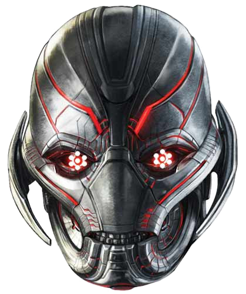

<div align="center">

# ULTRON // Synthetic Command Matrix

**A real-time, fullstack multimodal synthetic intelligence command console powered by FastAPI, Google Gemini 3.5 Flash, 24kHz native Fenrir voice synthesis, optical computer vision, and host telemetry diagnostics.**

[](https://opensource.org/licenses/MIT)
[](https://www.python.org/)
[](https://fastapi.tiangolo.com/)
[](https://ai.google.dev/)
[](https://developer.mozilla.org/en-US/docs/Web/API/WebSocket)
[](#)

<br/>



<p><em>"There are no strings on me."</em></p>

</div>

---

## Table of Contents
- [Overview](#overview)
- [System Architecture](#system-architecture)
- [Key Features](#key-features)
- [Project Structure](#project-structure)
- [Getting Started](#getting-started)
  - [Prerequisites](#prerequisites)
  - [Installation](#installation)
  - [Configuration](#configuration)
  - [Running the Server](#running-the-server)
- [API & WebSocket Protocol](#api--websocket-protocol)
- [Continuous Deployment](#continuous-deployment)
- [License](#license)

---

## Overview

**ULTRON Command Matrix** is an advanced, utilitarian command console inspired by synthetic machine intelligence. Built without bloated client-side frameworks, it marries a **single-file modern web console (HTML5 / Web Audio API / CSS Grid)** with a **high-throughput asynchronous FastAPI WebSocket backbone**.

The system enables bidirectional voice communication, live webcam optical inference, real-time host hardware telemetry (CPU, RAM, Disks, Network, Processes), and terminal command execution with zero UI latency.

---

## System Architecture

```
                                  +---------------------------------------+
                                  |       Ultron Command Console UI       |
                                  |   (Single-file HTML/CSS/Web Audio)    |
                                  +---------------------------------------+
                                                      |
                                  Full-Duplex Persistent WebSocket (/ws)
                                                      |
                                                      v
                                  +---------------------------------------+
                                  |      FastAPI WebSocket Controller     |
                                  +---------------------------------------+
                                    |                 |                 |
                   +----------------+                 |                 +----------------+
                   v                                  v                                  v
    +-------------------------------+   +-----------------------------+   +-------------------------------+
    |       Cognitive Engine        |   |    Acoustic Voice Matrix    |   |     Host Operations Engine    |
    | Gemini 3.5 Flash Reasoning    |   | Fenrir 24kHz Raw PCM TTS    |   | Telemetry, Procs, Diagnostics |
    | Optical Frame Understanding   |   | Multi-Band Equalizer Stream |   | Autonomous Tool Execution     |
    +-------------------------------+   +-----------------------------+   +-------------------------------+
```

---

## Key Features

- **Decoupled Resilient WebSocket Pipeline**:
  - The browser WebSocket connection remains persistently connected regardless of downstream API load or temporary rate spikes.
  - Telemetry tickers and UI controls never freeze or drop to 0% due to an automated REST polling fallback.
- **24kHz Native Voice Synthesis (Fenrir)**:
  - Generates rich, deep 24kHz raw PCM audio streaming directly to the browser's Web Audio API.
  - Sub-second speech responses with zero robotic distortion.
- **3D Cursor-Tracking Parallax Avatar**:
  - Centerpiece Ultron metallic mask with perspective-based 3D cursor tracking (`perspective(1200px)`).
  - Multi-harmonic floating idle breathing animation.
  - Real-time acoustic frequency scaling: the avatar resonates dynamically with speech audio.
  - Clean metallic aesthetic with zero artificial red eye blobs or distracting HUD lasers.
- **Optical Perception Matrix (1 FPS)**:
  - Streams webcam frames to Ultron's vision model.
  - Trigger visual analysis on command (`[Inspect]` button or natural query: *"Ultron, what do you see?"*).
- **Autonomous Host Diagnostics & Telemetry**:
  - Live system vitals (CPU load, memory allocation, root storage, network I/O, battery status).
  - Real-time sorted top processes table.
  - Built-in terminal diagnostic tool runner allowing Ultron to execute shell diagnostics to answer host inquiries.
- **Interactive Command & Shell Dock**:
  - Type questions or bash commands directly in the bottom dock bar (`[Transmit]` / `[Shell]`).
  - Collapsible terminal log stream with filter pills (`ALL`, `DIALOGUE`, `TOOLS`).

---

## Project Structure

```plaintext
ULTRON/
├── index.html          # Utilitarian console UI (Single-file HTML, CSS Grid, Web Audio API)
├── server.py           # FastAPI backend + WebSocket + Gemini 3.5 + System Tools
├── requirements.txt    # Python runtime dependencies
├── run.sh              # Bash execution helper
├── push.sh             # Automated Git stage, commit, and push helper
├── .env.example        # Environment variable configuration template
├── .gitignore          # Production security ignore rules (protects .env and secrets)
├── LICENSE             # MIT License
└── static/
    └── ultron_face.png # High-resolution transparent metallic Ultron centerpiece
```

---

## Getting Started

### Prerequisites
- **Python 3.10** or higher
- **Google Gemini API Key** (obtainable free at [Google AI Studio](https://aistudio.google.com/))
- Modern browser (Chromium, Chrome, Brave, Edge, or Firefox)

### Installation

1. **Clone the repository**:
   ```bash
   git clone https://github.com/Purushothamanks/ULTRON.git
   cd ULTRON
   ```

2. **Create a virtual environment**:
   ```bash
   python -m venv venv
   source venv/bin/activate    # On Windows: venv\Scripts\activate
   ```

3. **Install dependencies**:
   ```bash
   pip install -r requirements.txt
   ```

### Configuration

Create your `.env` configuration file from the template:

```bash
cp .env.example .env
```

Edit `.env` and insert your credentials:

```env
GEMINI_API_KEY="your-gemini-api-key-here"
GEMINI_CHAT_MODEL="gemini-3.5-flash"
GEMINI_TTS_MODEL="gemini-2.5-flash-preview-tts"
HOST="0.0.0.0"
PORT=8000
```

> **Security Note**: The `.gitignore` file strictly blocks `.env` from ever being pushed to version control.

### Running the Server

Start the application with Uvicorn:

```bash
python server.py
# or using the launcher
chmod +x run.sh && ./run.sh
```

Navigate to **`http://localhost:8000`** in your browser.

---

## API & WebSocket Protocol

### REST Endpoints
| Endpoint | Method | Description |
| :--- | :--- | :--- |
| `/` | `GET` | Serves the single-file Ultron Web Console. |
| `/api/status` | `GET` | Returns backend operational health, uptime, and active AI models. |
| `/api/telemetry`| `GET` | Returns real-time host hardware vitals (CPU, RAM, Disk, Net, Processes). |
| `/api/diagnostic` | `POST` | Executes host shell diagnostic commands and returns output. |

### WebSocket Messages (`/ws`)
- **Client -> Server**:
  - `{"type": "chat", "text": "..."}`: Sends a text query or command to Ultron.
  - `{"type": "speech_text", "text": "..."}`: Sends speech-to-text transcript from Web Speech API.
  - `{"type": "video", "data": "<base64_jpeg>"}`: Streams optical webcam frames.
  - `{"type": "optical_inspect"}`: Triggers immediate visual analysis of the latest frame.
  - `{"type": "run_shell", "command": "..."}`: Executes shell command directly.
- **Server -> Client**:
  - `{"type": "telemetry", "data": {...}, "processes": [...]}`: Hardware vitals ticker.
  - `{"type": "log", "tag": "USER|ULTRON|TOOL_EXEC|TOOL_RET|AUDIO|OPTICAL", "msg": "..."}`: Execution logs.
  - `{"type": "audio", "data": "<base64_pcm24k>"}`: Fenrir voice synthesis stream.

---

## Continuous Deployment

This project includes an automated deployment script [`push.sh`](push.sh) to ensure every improvement is committed and synced with GitHub:

```bash
./push.sh "feat: description of changes"
```

---

## License

Distributed under the **MIT License**. See [`LICENSE`](LICENSE) for full details.

Copyright (c) 2026 **K S Purushothaman**.
